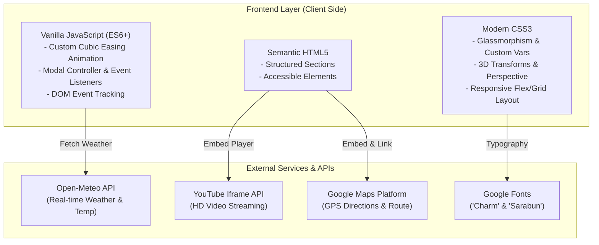

# <div align="center">🌲 ฮักเมืองแพร่ (Travel Phrae) 🐘</div>

<div align="center">

*สัมผัสเสน่ห์เมืองไม้สักทอง ลิ้มรสวิถีอาหารพื้นถิ่น แอ่วเมืองแป้ด้วยมุมมองร่วมสมัย*

[](https://github.com/sanior09/Travel-Phrae/stargazers)
[](https://github.com/sanior09/Travel-Phrae/network/members)
[](LICENSE)
[](https://developer.mozilla.org/en-US/docs/Web/HTML)
[](https://developer.mozilla.org/en-US/docs/Web/CSS)
[](https://developer.mozilla.org/en-US/docs/Web/JavaScript)
[](https://open-meteo.com/)

<br/>

[🌐 ชมเว็บไซต์ตัวอย่าง (Live Demo)](https://sanior09.github.io/Travel-Phrae/) • 
[✨ ฟีเจอร์เด่น](#-ฟีเจอร์เด่นและไฮไลท์ของระบบ) • 
[🗺️ ไฮไลท์สถานที่ท่องเที่ยว](#-สถานที่ท่องเที่ยวยอดนิยม-12-แห่ง) • 
[🚀 เริ่มต้นใช้งาน](#-วิธีการติดตั้งและเปิดใช้งานในเครื่อง-getting-started) • 
[📌 โครงสร้างโปรเจกต์](#-โครงสร้างไฟล์ในโปรเจกต์)

</div>

---

## 📖 เกี่ยวกับโปรเจกต์ (About Project)

**"ฮักเมืองแพร่ (Travel Phrae)"** เป็นเว็บแอปพลิเคชันท่องเที่ยวเชิงวัฒนธรรมและธรรมชาติ ที่รวบรวมข้อมูลสถานที่สำคัญ ร้านอาหารพื้นเมือง แหล่งของฝาก ที่พัก ตลอดจนขนบธรรมเนียมประเพณีของจังหวัดแพร่ เมืองแห่งประวัติศาสตร์ล้านนาตะวันออกและไม้สักทอง

ตัวเว็บถูกออกแบบด้วยแนวคิด **Modern Lanna Experience** ผสานความงดงามของศิลปะวัฒนธรรมล้านนาเข้ากับเทคโนโลยีเว็บสมัยใหม่ ทั้งการโต้ตอบแบบ 3 มิติ (3D Tilt & Dynamic Spotlight), ระบบดึงข้อมูลสภาพอากาศสดแบบเรียลไทม์ และระบบนำทางที่ลื่นไหล รองรับการแสดงผลสมบูรณ์แบบบนทุกอุปกรณ์

---

## ✨ ฟีเจอร์เด่นและไฮไลท์ของระบบ

```
   ┌────────────────────────────────────────────────────────────────────────┐
   │                       🌟 TRAVEL PHRAE CORE SYSTEM                      │
   ├──────────────────┬──────────────────┬──────────────────────────────────┤
   │ 🌤️ Live Weather  │ ⏰ Thai Clock    │ 🎯 3D Tilt & Dynamic Spotlight   │
   │ ดึงสภาพอากาศแพร่ │ แสดงวัน-เวลาสด   │ การ์ด 3 มิติตอบสนองตามพิกัดเมาส์ │
   │ จาก Open-Meteo   │ ปฏิทินไทย พ.ศ.   │ พร้อมแสงเงา Perspective          │
   ├──────────────────┼──────────────────┼──────────────────────────────────┤
   │ 🎬 Video Modals  │ 🗺️ Google Maps   │ 📱 Responsive & Audio Feedback   │
   │ ชมคลิปท่องเที่ยว │ พิกัด GPS นำทาง  │ เมนูมือถือ + เสียงคลิก + Smooth  │
   │ โดยไม่ต้องย้ายหน้า│ ไปยังจุดหมายจริง │ Scroll Ease-Out Cubic            │
   └──────────────────┴──────────────────┴──────────────────────────────────┘
```

### 1. 🌤️ ระบบตรวจวัดสภาพอากาศสด (Live Weather API)
- เชื่อมต่อกับ **Open-Meteo Forecast API** แบบเรียลไทม์ ณ พิกัดละติจูด/ลองจิจูดของจังหวัดแพร่ (`18.1446° N, 100.1403° E`)
- แปลงรหัสสภาพอากาศ WMO Weather Code เป็นภาษาไทย พร้อมไอคอนกราฟิกสภาพอากาศแบบไดนามิก
- อัปเดตข้อมูลอัตโนมัติทุก 15 นาที โดยไม่ต้องรีเฟรชหน้าเว็บ

### 2. 🕒 นาฬิกาและปฏิทินไทยเรียลไทม์ (Realtime Clock & Calendar)
- แสดงวันในสัปดาห์ วันที่ เดือนภาษาไทย และปีพุทธศักราช (พ.ศ.) คำนวณแบบอัตโนมัติ
- แสดงเวลาปัจจุบันแบบดิจิทัลวินาทีต่อวินาที (Digital Live Clock)

### 3. 🎴 การ์ด 3 มิติ และเอฟเฟกต์ไฟส่องตามเมาส์ (3D Tilt & Mouse Spotlight)
- ใช้ CSS 3D Transforms (`preserve-3d`, `perspective(1000px)`) จำลองมิติความลึกของการ์ดสถานที่
- ติดตามพิกัดตัวชี้เมาส์ (`--mouse-x`, `--mouse-y`) เพื่อสร้างแสงสปอตไลต์เรืองแสงแบบ Radial Gradient บนการ์ดแบบไดนามิก

### 4. 🎥 ระบบวิดีโอป๊อปอัปแบบฝัง (Interactive Video Modal)
- รองรับการเปิดชมสารคดีท่องเที่ยวแพร่จาก YouTube ผ่านระบบ Modal Overlay
- จัดการ Memory ปลอดภัย: หยุดเล่นและเคลียร์ Iframe อัตโนมัติเมื่อกดปิดหน้าต่าง

### 5. 🗺️ ข้อมูลสถานที่ละเอียด & ระบบนำทาง GPS (Place Details & Maps)
- ระบบ Modal ข้อมูลเชิงลึก: เวลาทำการ, วันเปิด-ปิด, เบอร์โทรติดต่อฉุกเฉิน/สอบถาม
- ปุ่ม One-Click นำทางด้วย Google Maps สู่พิกัดจริงของสถานที่

### 6. 🌊 การเลื่อนหน้าจอที่นุ่มนวลเป็นพิเศษ (Smooth Scroll with Easing)
- ใช้อัลกอริทึม **Ease-Out Cubic** (`(--t) * t * t + 1`) ควบคุมการเลื่อนหน้าจอด้วย `requestAnimationFrame`
- ปรับชดเชย Offset ความสูงของ Navbar อัตโนมัติ ป้องกันหัวข้อถูกแถบเมนูบัง
- มีแถบสถานะการอ่าน **Scroll Progress Bar** ด้านบนสุดของหน้าต่าง

---

## 🗺️ สถานที่ท่องเที่ยวยอดนิยม 12 แห่ง

| ลำดับ | สถานที่ | ไฮไลท์สำคัญ | วิดีโอแนะนำ |
| :---: | :--- | :--- | :---: |
| **01** | **วัดพระธาตุช่อแฮ พระอารามหลวง** | พระธาตุคู่บ้านคู่เมืองแพร่ พระธาตุประจำปีขาล หุ้มด้วยทองดอกบวบแท้ | `ชมได้ในเว็บ` |
| **02** | **คุ้มวงศ์บุรี (คุ้มสีชมพู)** | สถาปัตยกรรมไทยผสมยุโรป ไม้ฉลุลวดลายขนมปังขิง อายุกว่าร้อยปี | `ชมได้ในเว็บ` |
| **03** | **วนอุทยานแพะเมืองผี** | ปรากฏการณ์ทางธรณีวิทยา เสาดินและประติมากรรมธรรมชาติสุดมหัศจรรย์ | `ชมได้ในเว็บ` |
| **04** | **พิพิธภัณฑ์คุ้มเจ้าหลวง** | สถาปัตยกรรมสมัย ร.5 แบบยุโรปประยุกต์ ไม่มีเสาเข็ม และคุกโบราณใต้ถุน | `ชมได้ในเว็บ` |
| **05** | **วัดพระธาตุสุโทนมงคลคีรี** | ยอดงานพุทธศิลป์ล้านนาประยุกต์และพระนอนศิลปะพม่าขนาดใหญ่ | `ชมได้ในเว็บ` |
| **06** | **บ้านนาคูหา** | สัมผัสวิถีสโลว์ไลฟ์ท่ามกลางหุบเขา ชิมสาหร่ายน้ำจืด (เตา) และสะพานไม้ไผ่ | `ชมได้ในเว็บ` |
| **07** | **บ้านทุ่งโฮ้ง** | ต้นตำรับภูมิปัญญาผ้าหม้อห้อมย้อมครามแท้ชื่อดังระดับประเทศ | `ชมได้ในเว็บ` |
| **08** | **อ่างเก็บน้ำแม่มาน** | วิวทิวทัศน์ทะเลสาบกลางภูเขา เหมาะแก่การพักผ่อนและชมพระอาทิตย์ตก | `ชมได้ในเว็บ` |
| **09** | **วัดจอมสวรรค์** | วัดศิลปะไทยใหญ่ สร้างด้วยไม้สักทั้งหลัง หลังคายกชั้นลดหลั่นอย่างวิจิตร | `ชมได้ในเว็บ` |
| **10** | **น้ำตกแม่เกิ๋งหลวงและแม่เกิ๋งอ่อน** | น้ำตกหินปูนขั้นบันไดในอุทยานแห่งชาติเวียงโกศัย น้ำใสเย็นสบายตลอดปี | `ชมได้ในเว็บ` |
| **11** | **กาดกองเก่า (ถนนคนเดิน)** | สัมผัสวิถีชุมชน ชิมอาหารพื้นเมือง ช้อปปิ้งของฝากในบรรยากาศบ้านเรือนไม้เก่า | `ชมได้ในเว็บ` |
| **12** | **ถ้ำผานางคอย** | ถ้ำหินงอกหินย้อยตระการตา พร้อมตำนานรักอมตะของนางอรัญญาณี | `ชมได้ในเว็บ` |

---

## 🍲 หมวดหมู่เนื้อหาอื่น ๆ ภายในเว็บไซต์

- **🛌 ที่พัก & โฮมสเตย์ (Accommodations):** คัดสรรโรงแรม ที่พัก และบูทีครีสอร์ทชั้นนำในเมืองแพร่
- **🍜 อาหารพื้นถิ่นรสเด็ด (Local Delicacies):** แนะนำเมนูขึ้นชื่อ อาทิ ขนมจีนน้ำย้อย, ไส้อั่วเตาหลวง, ลาบเมืองคั่ว, แคบหมูน้ำพริกหนุ่ม
- **🎁 สินค้าของฝาก (Local Souvenirs):** ผ้าหม้อห้อมทุ่งโฮ้ง, เครื่องเรือนไม้สัก, กาแฟดอยช้าง/เด่นชัย
- **🏮 ประเพณีและวัฒนธรรม (Festivals & Events):** งานไหว้พระธาตุช่อแฮเมืองแพร่เปี๊ยกเต๊า, งานประเพณีสงกรานต์ดอกลมแล้ง, งานจุดผางประทีป

---

## 🛠️ โครงสร้างเทคโนโลยี (Tech Stack)



---

## 📁 โครงสร้างไฟล์ในโปรเจกต์

```text
Travel-Phrae/
├── .github/
│   └── workflows/
│       └── deploy.yml        # CI/CD สำหรับ Publish เว็บไซต์ขึ้น GitHub Pages
├── .gitignore                # จัดการไฟล์ที่ไม่จำเป็นสำหรับการ Commit
├── LICENSE                   # สัญญาอนุญาตการใช้งานแบบ MIT
├── README.md                 # เอกสารแนะนำและข้อมูลโปรเจกต์ (เอกสารนี้)
├── index.html                # โครงสร้างหน้าเว็บหลัก รวบรวม Section ข้อมูลทั้งหมด
├── style.css                 # สไตล์ชีท ตกแต่งดีไซน์ Responsive, 3D Card, Glassmorphism
└── script.js                 # ระบบคำนวณ Easing, นาฬิกา, Weather API, Modal Controller
```

---

## 🚀 วิธีการติดตั้งและเปิดใช้งานในเครื่อง (Getting Started)

ท่านสามารถดาวน์โหลดและรันโปรเจกต์บนเครื่องคอมพิวเตอร์ส่วนบุคคลได้โดยง่าย โดยไม่ต้องติดตั้งเฟรมเวิร์กขนาดใหญ่:

### 1. โคลนคลังโค้ด (Clone Repository)
```bash
git clone https://github.com/sanior09/Travel-Phrae.git
cd Travel-Phrae
```

### 2. เปิดใช้งานเว็บไซต์ (Running Locally)

เลือกวิธีใดวิธีหนึ่งตามความสะดวกของท่าน:

* **วิธีที่ 1 (แนะนำสำหรับ VS Code):**  
  ติดตั้ง Extension [Live Server](https://marketplace.visualstudio.com/items?itemName=ritwickdey.LiveServer) จากนั้นคลิกขวาที่ไฟล์ `index.html` แล้วเลือก **"Open with Live Server"**

* **วิธีที่ 2 (ผ่าน Python Built-in Server):**
  ```bash
  python -m http.server 3000
  ```
  จากนั้นเปิดเบราว์เซอร์ไปที่ `http://localhost:3000`

* **วิธีที่ 3 (ผ่าน Node.js npx):**
  ```bash
  npx serve .
  ```

---

## 🌐 วิธีนำขึ้นออนไลน์ผ่าน GitHub Pages (Deployment)

โปรเจกต์นี้รองรับการเผยแพร่เป็นเว็บไซต์สาธารณะฟรีผ่าน **GitHub Pages**:

1. ไปที่แท็บ **Settings** ใน Repository `sanior09/Travel-Phrae` บน GitHub
2. คลิกเลือกเมนู **Pages** ที่แถบเมนูด้านซ้าย
3. ในส่วน **Build and deployment > Source**:
   - เลือกเป็น `Deploy from a branch`
   - ใต้หัวข้อ **Branch** เลือก `main` และโฟลเดอร์ `/(root)`
   - กดปุ่ม **Save**
4. ระบบจะทำการ Deploy เว็บไซต์ให้ทันที ท่านสามารถเข้าใช้งานได้ที่:
   ```
   https://sanior09.github.io/Travel-Phrae/
   ```

---

## 🤝 การมีส่วนร่วมพัฒนา (Contributing)

ยินดีต้อนรับทุกคำแนะนำและการส่ง Pull Request เพื่อพัฒนาเว็บไซต์ให้ดียิ่งขึ้น:

1. ทำการ **Fork** โปรเจกต์นี้
2. สร้าง Feature Branch ของท่าน (`git checkout -b feature/AmazingFeature`)
3. ทำการ Commit การเปลี่ยนแปลง (`git commit -m 'Add some AmazingFeature'`)
4. Push ขึ้นสู่ Branch ของท่าน (`git push origin feature/AmazingFeature`)
5. เปิด **Pull Request** เพื่อตรวจสอบและรวมโค้ด

---

## 📄 สัญญาอนุญาต (License)

โปรเจกต์นี้เผยแพร่ภายใต้สัญญาอนุญาต **MIT License** — ท่านสามารถนำไปศึกษา พัฒนาต่อยอด หรือดัดแปลงได้อย่างเสรี ดูรายละเอียดเพิ่มเติมได้ที่ไฟล์ [LICENSE](LICENSE)

---

<div align="center">

สร้างสรรค์ด้วยความภาคภูมิใจในวัฒนธรรมล้านนา 💙 โดย [sanior09](https://github.com/sanior09)

*หากโปรเจกต์นี้มีประโยชน์ต่อท่าน อย่าลืมกด ⭐️ Star ให้กับ Repository นี้นะครับ!*

</div>
